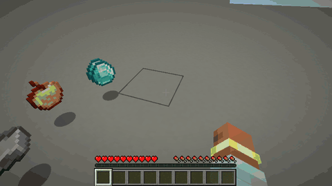
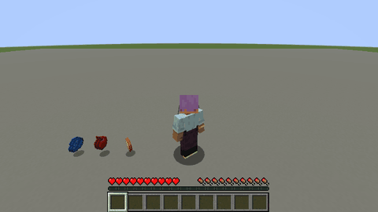

> ⚠️ **Disclaimer: This project is AI-generated.** The code, this description and the icon of this mod were created with generative AI (Claude by Anthropic), directed by me. While I am a professional software developer, I am not a Java developer, so I use generative AI to build mods that my friends and I want to play with, and I like to share the ones that work well with everyone. I understand if you do not want to support the use of generative AI, which is why I put this disclaimer here. If you run into any problems, please report them on GitHub.

# Item Pickup

Choose how you pick up items lying on the ground: automatically like in vanilla, or only the ones you actually want.

## Features

- **Vanilla mode** – unchanged Minecraft: everything near you is picked up automatically.
- **Manual mode** – walking over items does nothing. Look at an item and press the **pick up key** (right-click by default) to pick it up. Holding the key sweeps up a whole pile of drops.
  - The targeted item is **outlined** and its **name** and count are shown below the crosshair.
  - Items can be picked up within 2 blocks around you by default; solid blocks and entities in between hide them, grass and flowers do not.
  - Clicking an item does not also use the item in your hand, so you do not place a block on the floor by accident.
- **Toggle key** (`K` by default) switches between both modes while playing.

Both keys can be changed in *Options → Controls → Key Binds → Gameplay*.

## Installation

Install the mod on the **client** to use manual mode and on the **server** (or in singleplayer, which runs both), since the server decides what a player picks up. Either side alone is harmless: a client with the mod on a server without it stays in vanilla mode, and players without the mod can join a server with it. On Fabric, [Fabric API](https://www.curseforge.com/minecraft/mc-mods/fabric-api) is required.

## Configuration

`config/itempickup.properties` is created on first start and reloaded automatically when it changes. It can also be edited in game: on NeoForge in *Mods → Item Pickup → Config*, on Fabric through [Mod Menu](https://www.curseforge.com/minecraft/mc-mods/modmenu). Invalid values are marked red and cannot be saved, and every value can be reset to its default.

The mode at start, the pickup range (decided by the server in multiplayer), the outline and the name display can be configured.

## Versions

Available for **Fabric** and **NeoForge** on Minecraft **1.21 – 26.3**. Download the file that matches your loader and Minecraft version.

## Links

- [Source code](https://github.com/welles/minecraft-item-pickup)
- [Report a problem](https://github.com/welles/minecraft-item-pickup/issues)
- [Changelog](https://github.com/welles/minecraft-item-pickup/blob/main/CHANGELOG.md)
